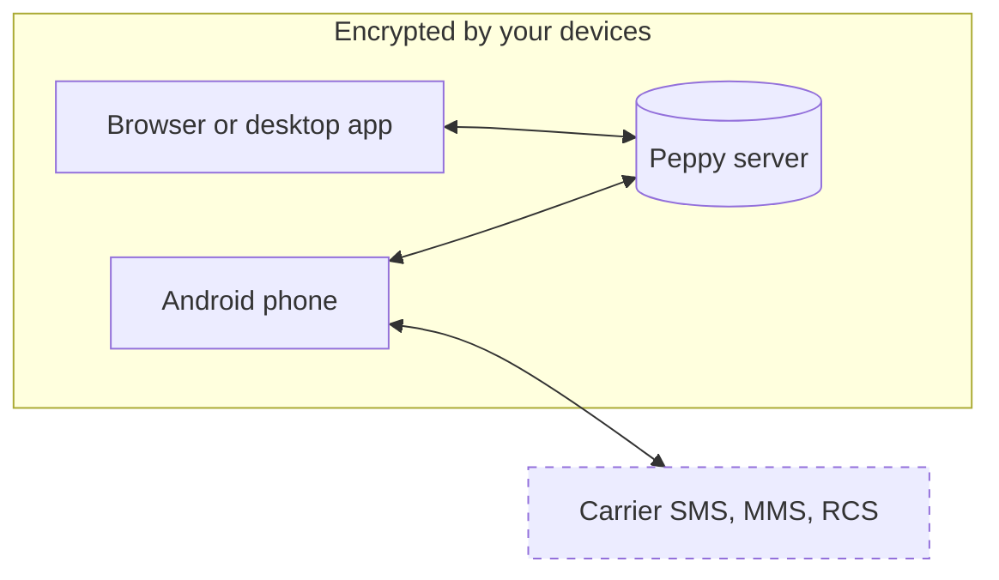

<div align="center">
  
  <h1>Peppy</h1>
  <p><strong>Private messaging on a server you control.</strong></p>
  <p>
    Read and answer your phone's texts from a browser or desktop app.<br />
    Your devices encrypt what they sync, on Peppy Hosted or on your own server.
  </p>
  <p>
    <a href="https://github.com/mattv8/peppy/actions/workflows/ci.yml"></a>
    <a href="Cargo.toml"></a>
  </p>
  <p>
    <a href="#get-the-apps">Get the apps</a> ·
    <a href="#peppy-hosted">Peppy Hosted</a> ·
    <a href="#self-host">Self-host</a> ·
    <a href="CONTRIBUTING.md">Contributing</a>
  </p>
</div>

https://github.com/user-attachments/assets/1799b04c-8ae9-4061-bc6e-419248b7bb96

## What you can do

- **Text from your computer.** Send and receive SMS through your Android phone from the browser or desktop app. MMS, for pictures and group texts, is opt-in and experimental.
- **Keep your RCS chats.** Link Google Messages on your phone to send and receive RCS text in the one-to-one chats and groups it already has.
- **Use your phone's contacts.** Browse them on the desktop and request edits. The phone that owns a contact applies the change under its own contact-sync setting.
- **See phone notifications on your desktop.** Android notification mirroring is opt-in, and you choose which apps it includes.
- **Keep conversations close.** On macOS and Windows, the desktop app sits in the menu bar or system tray and shows your unread count. You can pin up to eight floating conversations.
- **Connect AI clients and automations.** On a server that runs the optional MCP worker, you can give each AI client its own read and send permissions and add signed webhooks for incoming SMS and MMS.
- **Share a server.** On a self-hosted server, the administrator can invite other people to create their own separate vaults.

## How it works



Your phone still sends and receives every text. Peppy on Android runs beside your usual messaging app, copies messages into an encrypted vault, and sends what you write on your other devices.

The server stores that vault and passes it between your devices. It never receives your Vault key phrase.

The dashed box is your carrier's network. Peppy's encryption does not reach it, so a text sent through Peppy is as private as any other SMS, MMS, or RCS message.

<a id="clients"></a>
<a id="release-channels"></a>

## Get the apps

| Device | What it does | How to get it |
| --- | --- | --- |
| Browser | Full messaging in a desktop browser. | Open your server's HTTPS address. |
| macOS, Windows, Linux | Desktop app with notifications and floating conversations. | [GitHub Releases](https://github.com/mattv8/peppy/releases) |
| Android | Companion app that connects your phone's texts, contacts, and notifications. | The APK in the latest `android-v*` [release](https://github.com/mattv8/peppy/releases) |
| iPhone and iPad | Sync, contacts, and device management. It cannot send or receive carrier texts. | No installable build yet. |

Android releases are numbered separately from desktop releases.

[Full guide →](https://peppy.pro/docs/apps)

### Connect your phone

1. Set up Peppy in the browser or desktop app.
2. Select the **Connect a phone** icon in the title bar. Peppy shows a QR code. The icon appears for the vault owner, and only while no phone is connected.
3. Scan the code with Peppy on your phone.
4. Check that both devices show the same verification code, then approve.

On a self-hosted server, you can also join from any device by entering the server address and your Vault key phrase.

On Android, texting needs SMS permission and mirroring needs notification access. Peppy does not ask to become your default messaging app.

[Full guide →](https://peppy.pro/docs/connect-phone)

## Peppy Hosted

Peppy Hosted is the managed service: the same apps, with the server run for you. Sign in at [peppy.pro](https://peppy.pro) to create an account, subscribe, and download the apps.

[Full guide →](https://peppy.pro/docs/hosted)

## Self-host

The Community server runs with Docker Compose. You need:

- Docker Engine with Docker Compose v2.24 or newer.
- For access from other devices, a hostname that resolves to the server, with ports 80 and 443 open.

The Compose file needs only a `.env` beside it.

1. Create your environment file.

   ```sh
   cp .env.example .env
   ```

   In `.env`:

   - Set `PEPPY_ENV=production`.
   - Replace `POSTGRES_PASSWORD`, `PEPPY_RUNTIME_DB_PASSWORD`, `PEPPY_MAINTENANCE_DB_PASSWORD`, `S3_ACCESS_KEY`, and `S3_SECRET_KEY` with long random values. The three database passwords can contain only letters, digits, and `.` `_` `~` `-`.
   - Set `PEPPY_SERVER_IMAGE` to the release's `hub.docker.visnovsky.us/library/peppy-server@sha256:...` digest. Verify it first, as the [Community image guide](.agents/ops/backup-restore.md#prebuilt-community-edition) describes.
   - Set `PEPPY_SETUP_TOKEN` if you want setup to require a code. See [First-run setup](#first-run-setup).

2. Start the server.

   ```sh
   docker compose up -d
   ```

   It listens on `http://127.0.0.1:7000` and serves the browser client at that address.

3. Add HTTPS so other devices can connect. Set `PUBLIC_HOST` to your hostname, set `PUBLIC_API_URL` and `PUBLIC_ATTACHMENT_URL` to its `https://` address, then add the Caddy overlay.

   ```sh
   docker compose -f docker-compose.yml -f infra/compose/compose.caddy.yml up -d
   ```

   Caddy publishes ports 80 and 443. If you use another reverse proxy, set `TRUSTED_PROXY_CIDRS` to that proxy's addresses only.

4. Open the address in a browser, or enter it in a desktop or mobile app, and finish setup.

To check a running server, request `/healthz` for the process and `/readyz` for the database, migrations, and attachment storage.

To build from source instead, see [CONTRIBUTING.md](CONTRIBUTING.md).

[Full guide →](https://peppy.pro/docs/self-host)

<a id="first-run-setup-and-device-connections"></a>

### First-run setup

The first device to finish setup becomes the administrator and creates the first vault.

A new server is open by default: anyone who can reach it can claim it during the 60 minutes after it starts. After that, restart the server to continue setup. To require a setup code instead, set `PEPPY_SETUP_TOKEN` to a random value of at least 32 bytes before you start the server.

Setup involves three separate secrets:

| Secret | What it is for |
| --- | --- |
| Setup code | Claims a token-protected server. It is the value of `PEPPY_SETUP_TOKEN`. |
| Administrator password | Signs you in to manage the server. |
| Vault key phrase | Protects your messages and admits new devices. Peppy generates it. |

Save the Vault key phrase when Peppy shows it. The server never has it, so neither the server nor its logs can give it back.

[Full guide →](https://peppy.pro/docs/self-host/first-setup)

<a id="recover-from-an-unwanted-first-claim"></a>

### Recover from an unwanted first claim

If someone else claims your server first, Peppy cannot reset their password or hand the server back. You have to erase the server and set it up again:

1. List the volumes of the affected Compose project and confirm their names. Compose prefixes each with the project name.

   ```sh
   docker volume ls --filter "label=com.docker.compose.project=$PROJECT"
   ```

2. Stop that deployment and remove its containers, but not its volumes.
3. Remove only that project's `postgres-data`, `seaweed-volume-data`, and `seaweed-filer-data` volumes.
4. Set `PEPPY_SETUP_TOKEN` in `.env`, start the deployment with the same project name, Compose files, and `.env`, then complete setup straight away.

This permanently destroys every vault and attachment on that server. Do not run `docker compose down -v`, and never remove another project's volumes. A development stack from the same checkout uses the same volume names, so check the project before you delete. If your database or attachment storage is external, clear only Peppy's own database and attachment data there instead.

Read the [backup and restore guide](.agents/ops/backup-restore.md) before you remove anything.

[Full guide →](https://peppy.pro/docs/self-host/recover-claim)

### Update

Back up first. Verify the new release's signature and set `PEPPY_SERVER_IMAGE` to its digest. Existing self-hosters should note that `infra/compose/compose.community.yml` is gone; the root file now replaces it. The [backup and restore guide](.agents/ops/backup-restore.md) and the [release update guide](.agents/ops/release-updates.md) have the details.

Peppy runs on a single node. It is not a high-availability deployment.

[Full guide →](https://peppy.pro/docs/self-host/updates)

## What Peppy protects, and what it does not

- Your devices encrypt messages, attachments, and contacts before they sync. The server stores the encrypted data and never receives your Vault key phrase.
- SMS, MMS, and RCS travel through your carrier or Google Messages, outside Peppy's encryption.
- Everyone who knows the Vault key phrase can read the vault. Removing a device does not take the phrase away from someone who knows it. Rotating the phrase protects new messages only: anyone who had the old phrase can still read earlier history.
- A public image link publishes a separate, unencrypted copy of that image. The link has its own expiry and can be revoked.
- Turning on MCP lets the server hold keys for that vault. Webhooks send message text to the address you choose.
- Peppy does not claim forward secrecy, and it has not had an external security audit.

[Full guide →](https://peppy.pro/docs/security)

## Status

Peppy is in active development. MMS is experimental, pictures and files over RCS are still in progress, and carrier behavior varies by phone and network.

## Contributing

Read [CONTRIBUTING.md](CONTRIBUTING.md) for development workflows, checks, and supported toolchains.

## License

Peppy is licensed under [Apache-2.0](Cargo.toml), as declared in the workspace manifest.
