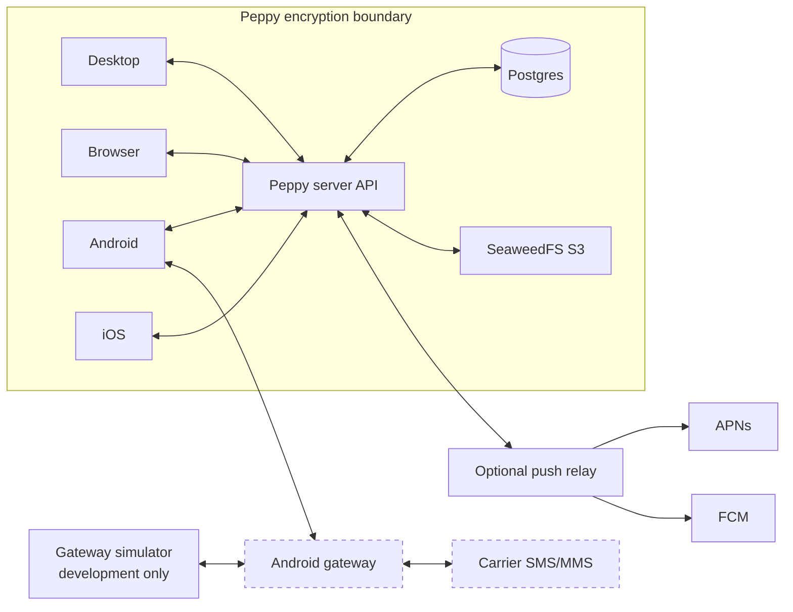

# Peppy

<div align="center">
  <h1>Private messaging on a server you control.</h1>
  <p><em>Connect browser, desktop, Android, and iOS clients to your self-hosted Peppy server.</em></p>
</div>

<p align="center">
  <a href="https://github.com/mattv8/peppy/actions/workflows/ci.yml"></a>
  <a href="Cargo.toml"></a>
</p>

<p align="center"><a href="CONTRIBUTING.md">Contributing Guide</a></p>

## Table of Contents

- [Overview](#overview)
- [Quick Start](#quick-start)
- [Clients](#clients)
- [Post-install and first run](#post-install-and-first-run)
- [Server-resident MCP](#server-resident-mcp)
- [Concepts](#concepts)
- [Operations](#operations)
- [Contributing](#contributing)
- [License](#license)

## Overview

Peppy stores encrypted vault data on a server you run. Use the browser client at your server address, install the desktop client, or connect Android and iOS clients. Android can act as a companion gateway for supported SMS and experimental MMS; iOS does not provide carrier messaging in this build.

### Features

- Encrypted vault envelopes, private attachments, snapshots, and device synchronization.
- Browser messaging served at the Community server's public root by default.
- Native desktop, Android, and iOS clients.
- Android companion features for supported SMS, opt-in experimental MMS, contacts, and notification mirroring.
- Optional push-relay wake hints for supported mobile platforms.

### Status

Development remains in progress. The gateway simulator uses synthetic messages and does not represent a carrier. CI and release downloads are build evidence, not proof of carrier support, store readiness, installer trust, or production readiness. Peppy has not received an external security audit.

SMS and MMS travel outside Peppy's encryption boundary. Keep private originals private: a public image link publishes a separately supplied plaintext derivative.

### Components

| Component | Use |
| --- | --- |
| Peppy server | Authenticates devices and stores encrypted envelopes, attachments, and snapshots. |
| Browser client | Messaging UI served with the Community server image. |
| Desktop client | Native Tauri client for macOS and Windows; Linux packages ship as stable release artifacts. |
| Android gateway | Companion for supported SMS, experimental MMS, contacts, and notification mirroring. |
| iOS client | Sync, contacts, device management, and optional wake enrollment. Carrier messaging and notification listening are unavailable. |
| Gateway simulator | Synthetic SMS and carrier-effect exercise for local development only. |

See [Clients](#clients) for installation, setup, permissions, and platform limits. Advanced operators and contributors can use the [agent references](.agents/AGENTS.md).

### Architecture



Carrier SMS/MMS is outside the encryption boundary. Push relays carry content-free wake hints and provide best-effort wake-up, not message delivery evidence.

## Clients

All clients can connect with the server address and vault shared secret. An authorized browser or desktop owner can also show **Connect your phone**: scan it on the phone, compare the locally computed verification codes, then approve encrypted key transfer or enter the shared secret. The server receives neither the QR secret nor plaintext vault keys.

### Android gateway

Install the Android APK from the matching `android-v*` release. It is a companion to the default messaging app, not a replacement. After enrollment and unlock, use **Mirroring**, **SMS**, **Contacts**, **Account**, and Settings. Conversation and composition stay in the shared product interface.

Android can be the first owner of a self-hosted server. The setup wizard shows whether first claim is open or token-protected. Open claim needs no setup code. Token-protected claim needs the operator code and an administrator password, then generates the vault shared secret. The setup code authorizes only the initial claim; the password manages the server; the secret protects vault data. A phone that joins an existing vault is a gateway. Phones do not show a pairing QR, **Add a computer**, or a QR in Settings. See [Recover from an unwanted first claim](#recover-from-an-unwanted-first-claim) if someone else claims the server.

For Peppy Hosted, use native Google sign-in to create or access an account. The direct APK opens Peppy's website for billing, which can require the same Google account. The Play-distribution build uses Google Play for eligible Hosted subscriptions when the server reports Play billing as available; otherwise it does not offer new Play purchases. Access from an existing subscription comes from the server's entitlement, whichever provider sold it. The app checks the server entitlement before creating a vault. Delete a hosted account on Peppy's website at https://peppy.pro/account/delete; account deletion is separate from disconnecting a device or deleting a vault. Android keeps passphrase generation and confirmation in the native interface; it resumes interrupted setup with protected material. Native Apple authentication is unavailable.

The Account tab shows the server-reported role and device list. Any device can disconnect itself. Only an owner can remove another device or access the typed-`ERASE` vault-delete control. Disconnect archives local encrypted state; it does not reset the device or prove a revoked credential can sync again.

Android can capture supported SMS broadcasts and submit permitted SMS commands. It requests `RECEIVE_SMS` and `SEND_SMS`. Experimental MMS capture also needs `READ_SMS` and `RECEIVE_MMS`; notification mirroring needs Android notification-listener access. Peppy does not request `WRITE_SMS`, the default-SMS role, or hidden carrier APIs. Default-SMS status and SIM availability do not grant RCS access. Some Android versions expose additional provider rows only after a separate restricted-message AppOp is allowed; **MMS → Sync details** shows its status and a command to copy. The Play Store build cannot grant this access itself; use the copied adb command from a computer. The APK downloaded from GitHub releases can grant it through on-phone Wireless debugging setup. Recovering skipped provider rows is queued work, not message delivery evidence, and it can copy only rows the provider exposes; it does not add RCS sending support.

The GitHub-release APK includes on-phone restricted-message setup and bundles LGPL-3.0 spake2-android, Apache-2.0 libadb and Conscrypt (with BoringSSL), and Bouncy Castle. Their notices are in `assets/third_party` and shown under **Account → About → Open-source licenses**; the Play build does not include them.

SMS/MMS synchronization, silent-message skipping, and Wi-Fi-only media are permission and capability gated. Wi-Fi-only means an active Wi-Fi transport, not an unmetered connection. New notification mirroring is off by default. It excludes Peppy's own notifications, duplicate default-SMS notifications, group summaries, ongoing/progress notifications, and empty notifications. Enable it only after updating participating clients; older builds quarantine unfamiliar records without retrying them after an upgrade.

**Sync read status with phone** is off by default. It reads the provider read flag for captured inbound SMS and downloaded MMS, then marks that exact message read in Peppy and on authorized devices. It never changes phone messages or marks messages unread. It needs SMS sync and `READ_SMS`; MMS also needs MMS sync. It does not need notification access and works on Android 8. Each pass considers up to 500 unread candidates per transport and catches up after later provider changes, foreground/read-permission recovery, or 15-minute periodic work. Android may delay background work, so catch-up has no strict delivery time.

The optional SMS-only Peppy-to-phone read action needs Android 9+ and notification access. It uses the exposed mark-read action of the current default messaging app only after strict, unambiguous captured-SMS evidence, and never retries a consumed, expired, cancelled, crashed, or uncertain attempt. It cannot retract an action already handed to Android. It may wait for an unlocked phone. RCS remains unavailable, and a conversation-wide app action can include RCS or another simultaneous message.

Commands use the current default-SMS subscription. Commands for a changed or missing route stay pending rather than moving to another SIM. MMS never downgrades to SMS. Carrier behavior, restricted-permission approval, and physical SMS/MMS delivery require a device and carrier test; an emulator does not establish them.

Enable contact sync separately. The phone publishes and owns its address book and applies remote edits under its local Auto, Confirm, or Off policy. Permission loss and incomplete scans do not delete contacts. Photos are private encrypted 256×256 JPEG attachments limited to 64 KiB. Doze, force-stop, provider behavior, and background scheduling can delay sync.

Experimental MMS needs clients that support content version 2+. The default messaging app downloads carrier MMS; Peppy scans provider parts and uploads completed encrypted records. It uses the carrier-reported size limit or a conservative 300 KiB fallback. Confirmed send differs from delivery, and uncertain sends do not retry automatically. Enabling capture starts resumable history capture for downloaded sent and received MMS, not RCS or undownloaded attachments. Turning capture off keeps its checkpoint. Version-3 captures add encrypted image previews and supported-video posters/duration; a preview failure keeps the original. Desktop and browser clients can browse previews and request originals. Group replies use the default-SMS SIM's own number, read with `READ_PHONE_NUMBERS` on Android 13+ or existing `READ_SMS` on earlier releases; enter it manually when the carrier does not provide it.

For eligible Peppy Hosted enrollment, Background updates register automatically when the hosted server advertises FCM support. You can pause or resume the setting in Account. Community relays retain manual origin and enable controls. Registration can be delayed by connectivity, process death, quota, or locked keys. Wakes contain no message content, do not authorize carrier work, and do not promise immediate delivery. The repository does not claim a live signed FCM delivery path.

Diagnostics are off by default. On a test phone, enable **Settings → Diagnostics** to record bounded numeric timing and counters locally, then turn it off after collecting a trace. **Share log** creates a bounded private snapshot. Peppy does not collect logcat, message bodies, phone or provider IDs, URLs, credentials, response bodies, or exception text. Emulator tests and APK builds do not establish carrier, FCM, store, physical-network, latency, or battery behavior.

### Desktop

Install stable macOS, Windows, or Linux release artifacts from [GitHub Releases](https://github.com/mattv8/peppy/releases). Enter the server address to discover its setup state. The desktop client can make the first self-hosted claim, sign in as an administrator, or enroll with a shared secret. It keeps passwords and vault secrets in native dialogs. The setup and recovery rules match [First-run setup and device connections](#first-run-setup-and-device-connections) and [Recover from an unwanted first claim](#recover-from-an-unwanted-first-claim).

When no phone is connected, an enrolled owner can use the titlebar **Connect a phone** icon to show one **Connect your phone** QR. The icon is shown only to that owner while no phone is connected. There is currently no separate in-app path for adding another phone later. Settings does not show QR codes. App lock is off by default. When enabled, it takes effect at the next start and uses a local native password separate from the server password and vault secret.

MMS needs an enabled, permission-ready Android gateway with MMS content version 2+. Upgrade paired clients together. Groups and attachments select MMS; replies in an MMS conversation keep that transport, and a missing capability preserves the editable draft. Retry controls retry the encrypted file transfer, not the carrier message. The client downloads version-3 previews for browsing and requests originals on demand. Legacy originals up to 2 MiB download automatically. It groups consecutive images from the same known sender within three minutes, preserves each message's status, and provides a paged **Media** view with a keyboard-navigable viewer. Video and audio start only after user action; unsupported formats retain **Save**. **Save** uses a native dialog and never exposes filesystem paths or encryption keys to the webview. Media viewing or saving does not create a public link. Carrier limits include encoded headers, so the displayed estimate is only a lower bound; a fallback limit is labeled as an application limit, and gateway validation can reject it. Unknown carrier outcomes do not retry automatically. Incomplete phone acquisition remains in the phone health view until all parts arrive; after that, the event remains in the outbox until upload, and upload failures appear in transfer health. Android MMS remains experimental pending physical-carrier acceptance; RCS is unavailable.

Enable contact sync on each phone before using **Contacts**. You can search, edit supported fields, crop a photo, create or delete a contact, and inspect the owning phone's result. A request stays pending until that phone applies it. iOS notes are read-only. Names and avatars resolve for messaging and recipient discovery without changing stored delivery addresses; ambiguous shared numbers fall back to the number. Unsaved edits remain when you switch contacts, books, or the main rail until you save or discard them. **Recently deleted** retains contacts for 90 days. **Forget** permanently hides a book and its name/avatar matches on this desktop but does not delete phone contacts. **Repair** rebuilds the desktop cache from a fenced server snapshot, preserves phone-owned state and pending effects, and cannot recover an upload that never reached the server. It reports missing keys, incomplete repair, and paused retention. See [Compaction and recovery](#compaction-and-recovery).

On macOS and Windows, closing the main window keeps Peppy in the menu bar or system tray. Use **Open Peppy** to return or **Quit Peppy** to exit; quit waits for draft saves. The tray badge shows unread totals from `1` through `99+`, and its tooltip shows the exact total. An app or vault-key lock shows a lock badge, while an unavailable or revoked account restores the plain Peppy icon. Peppy keeps its tray status item for the process lifetime. Windows refreshes DPI rasterization when the badge changes or a failed apply retries; an unchanged state does not recreate the icon. **Start at login** is off by default. If the tray cannot start, Peppy opens the main window.

You can pin up to eight floating conversations. Use the popout button to open one, **–** to collapse it, **×** to save its draft and close it, and **Dismiss head** to unpin it. Peppy remembers each conversation's size and position and restores saved pins collapsed when the local account is available. Floating conversations work offline and do not require unlocked device sync. Native circle input, focus, and multi-monitor behavior require testing on each target OS.

### iPhone and iPad

This SwiftUI client can enroll, unlock, sync, manage its device account and contacts, and opt into wake updates. It has Mirroring, SMS, Account, and Settings surfaces, while conversation, composition, and feeds stay in the shared product interface. It cannot execute or listen for carrier SMS/MMS, listen to system notifications, or use RCS. It reports those functions as unavailable.

The client can make a first claim or join a vault with a shared secret or approved phone QR. It uses device-only Keychain storage; backup does not restore or synchronize those records. Only owners can remove another device or see vault deletion. Disconnect archives the encrypted database, keys, and queued work; it does not reset the device or prove a revoked credential can sync.

For Peppy Hosted, native Google sign-in uses the app's account session and the server's entitlement checks. Billing opens Peppy's website and can require signing in again with the same Google account. Native Apple authentication is unavailable.

Foreground sync stops when the app leaves the foreground. Contacts can request bounded background work, but iOS decides when it runs. Background execution does not promise immediate remote edits. For eligible Hosted enrollment, APNs registration and wake updates are automatic unless you had turned the relay setting off. The toggle stops registration and local wake processing. Community relays remain an optional manual setup. Hints have no message body, only start bounded sync or contact work, and never authorize carrier work. APNs and background scheduling do not prove delivery or immediate locked-phone work.

### Browser

Open your server's HTTPS address in a desktop browser. The client requires SharedWorker, WebAssembly, IndexedDB, Web Locks, and same-origin HTTPS. It starts with 512 MiB of Emscripten memory; insufficient allocation prevents startup. IndexedDB stores encrypted checkpoints and notification preferences, subject to browser storage limits. Constrained and mobile browsers can show an unsupported message.

The browser client uses the server's canonical API origin for enrollment and gets the QR origin from `/web/config.json`. It handles passphrases and credential imports outside React state, and does not return device tokens or encryption keys to the page. Browser storage retention remains platform-dependent. Browser operation does not prove production deployment, phone enrollment, carrier execution, or native integration.

## Quick Start

### Prerequisites

- Docker Engine with Docker Compose v2.24 or newer.
- The Community image, `hub.docker.visnovsky.us/library/peppy-server`, pinned to an immutable digest.
- For public HTTPS, a hostname that resolves to the server and allows ports 80 and 443.

### Setup

1. Create your environment file.

   ```sh
   cp .env.example .env
   ```

    Set strong, unique values for `POSTGRES_PASSWORD`, `PEPPY_RUNTIME_DB_PASSWORD`, `PEPPY_MAINTENANCE_DB_PASSWORD`, `S3_ACCESS_KEY`, and `S3_SECRET_KEY`. `POSTGRES_USER` is the migration/owner role; the runtime role is NOBYPASSRLS and the maintenance role is separate for cross-vault cleanup. Set `PEPPY_SERVER_IMAGE` in your shell or `.env` to the release's immutable `hub.docker.visnovsky.us/library/peppy-server@sha256:...` reference. The Community overlay requires that variable. The [Community image guide](.agents/ops/backup-restore.md#prebuilt-community-edition) covers image verification. `.env.example` defaults to development; set `PEPPY_ENV=production` for production.

2. Start the Community server.

   ```sh
   docker compose -f docker-compose.yml -f infra/compose/compose.community.yml up -d
   ```

   The default listener is `http://127.0.0.1:7000`. PostgreSQL and SeaweedFS do not publish host ports. The server serves the browser UI at its public root unless `WEB_UI_ENABLED=false`.

   #### RLS role upgrade

   The Compose bootstrap script creates the runtime and maintenance roles only for a new PostgreSQL volume. Before upgrading an existing volume to an RLS-enabled image, back it up and have a PostgreSQL administrator create the two roles using the same attributes as `infra/compose/bootstrap-roles.sh`. The migration-owner role does **not** create roles; it applies migrations and grants after the administrator bootstrap. With the stock Compose bootstrap, `POSTGRES_USER` is also PostgreSQL's initial superuser; resolver bodies therefore remain schema-qualified with hardened search paths. Operators with external PostgreSQL provisioning should prefer a distinct non-superuser schema owner and reserve the protected superuser for role/bootstrap administration. Do not point the API at the owner URL or grant the runtime role membership in it. Compose exposes the owner URL only to the one-shot migration command; the API receives only the runtime and maintenance URLs. The API must use the runtime URL and the maintenance worker must use the maintenance URL. If role validation reports missing policies, grants, or resolvers, leave the API stopped and repair the administrator bootstrap/migration step rather than bypassing RLS. The runtime role can read, insert, and update instance-control rows but cannot delete them; maintenance performs retention deletes.

3. Optional: add the supplied Caddy TLS overlay. Set `PUBLIC_HOST` to the externally reachable HTTPS hostname. Set `PUBLIC_API_URL` and `PUBLIC_ATTACHMENT_URL` to that external HTTPS origin, then run:

   ```sh
   docker compose -f docker-compose.yml -f infra/compose/compose.community.yml -f infra/compose/compose.caddy.yml up -d
   ```

   Caddy publishes ports 80 and 443. If you use another reverse proxy, set `TRUSTED_PROXY_CIDRS` only to its direct peer addresses or narrow CIDRs. The Caddy overlay is a starting configuration, not production-readiness evidence.

4. Open the server address in a browser or enter it in a desktop or mobile client.

For a source-based local development stack, use `just dev-setup` and `just dev-up`. Run `just smoke-infra` to start the root stack, check `/healthz` and `/readyz`, and run the storage check.

### Server-resident MCP

Peppy MCP is an opt-in, always-on client that runs beside the API on the same server. It is not a desktop bridge or a separate public hostname. For a release deployment, use matching, signed immutable API and worker image digests:

```sh
docker compose -f docker-compose.yml -f infra/compose/compose.community.yml -f infra/compose/compose.mcp.yml -f infra/compose/compose.community-mcp.yml up -d
```

Set `PEPPY_SERVER_IMAGE` and `PEPPY_MCP_IMAGE` to matching approved release digests. Do not mix a pinned API image with an arbitrary checkout-built worker. Obtain the companion worker's immutable digest from the release image publication and verify its signature before enabling this overlay. Use the operator-published Cosign public key, the same key the release publisher verifies with before promotion:

```sh
cosign verify --key <operator-published-cosign.pub> hub.docker.visnovsky.us/library/peppy-mcp@sha256:<digest>
```

Do not enable the overlay if verification fails or no digest-bound signature is found.

For source development only, omit the two Community overlays:

```sh
docker compose -f docker-compose.yml -f infra/compose/compose.mcp.yml up -d
```

The overlay publishes no worker port. The existing server origin exposes `/mcp`; the API reaches the worker only on the private Compose network. The worker runs as UID 10001 with a read-only root filesystem. Its durable `mcp-state` volume holds encrypted client state, while the worker-owned `mcp-control` volume supplies a control token read-only to the API. The worker creates its control token and storage key only in an empty initialized volume. Keep both volumes private. Store the worker state on a local filesystem: its single-node lock does not support network filesystems or HA sharing.

When backing up MCP, use the same MCP Compose overlays that run the worker. The backup stops the worker and adds the private, `0600` `mcp-state.tar.gz` archive to the backup set; it contains the storage key and must receive the same protection as vault recovery material. It never archives or records `mcp-control`: the worker regenerates that control token in a fresh control volume. Restore with the identical MCP overlays, to a fresh Compose project with no target volumes. Restore recreates only `mcp-state`, leaves the control volume to normal initialization, and does not start MCP; review the recovered deployment, then start it deliberately.

Peppy Hosted keeps MCP optional. Operate one separately managed worker per hosted environment, with one stable private DNS alias and external state/control volumes shared only with the active API colors. Start and verify that singleton before applying its API overlay to either color. Upgrade or cut over the worker only while it is stopped; never run two workers against the same state volume. Existing Hosted releases that do not use the MCP overlays remain unchanged.

In the desktop or web **Settings → Devices** view, an unlocked vault owner can enable Peppy MCP after accepting that the self-hosted server operator can hold the selected vault's purpose keys in the same-server worker. The current server is selected automatically. Enabling creates an ordinary enrolled device for that vault; it does not add a paid entitlement or require an enrollment CLI. The UI lists each authorized AI client and its read, text-send, and image-send permissions. Reapprove when the displayed status or epoch requires it. Mobile clients show the generic device roster; Android carrier behavior is unchanged and still requires its permission-ready Android gateway. iOS has no carrier executor, so MCP has no carrier effect there.

Peppy MCP reads and sends only within an authorized client grant. Refreshing a token reissues the grant's full approved scope; create a new grant when a client needs fewer permissions. To connect an AI client, add `https://your-server/mcp` as a remote Streamable HTTP MCP server using OAuth. When it opens Peppy, unlock the vault on an owner device and approve only the requested permissions it needs. To verify the connection safely, ask: `List the available Peppy tools and their permissions. Do not read messages or send anything.` The AI client must be able to reach the server address. A cloud-hosted client cannot use an address that works only on a private network. Browser-based external MCP clients from another origin are unsupported: `/mcp` does not provide cross-origin browser access. Dynamic client registrations that remain idle without an authorization or live token expire after 24 hours and must register again. SMS and MMS still require an enabled, permission-ready Android gateway. A reaction-text request sends the literal text as a message; it is not a native carrier reaction. Queued sends are not delivery evidence, and an uncertain carrier outcome is not retried automatically.

Removing the MCP device or revoking a client grant fences new MCP access. Cleanup of the server-side worker state is reported separately, and revocation cannot erase copies that an external AI client already received. If a backup or restore loses any bound component (the SQLCipher database, media and their keys, protected client cache, or device credential), remove and re-enable MCP from an unlocked owner device rather than trying to recreate the binding from a partial backup.

#### Webhooks

An unlocked vault owner can add up to 10 outbound webhooks per vault in desktop or web **Settings → Advanced**. A webhook fires for each inbound SMS or MMS and filters by sender: `all` sends every inbound message, `only` sends messages from the listed contacts or numbers, and `except` sends every message except those. Up to 50 filter entries are allowed per webhook. Delivery runs on the server-resident MCP worker, so no desktop, browser, or phone needs to be online. Webhooks need no extra configuration: they are available whenever Peppy MCP is enabled, and every control is in the settings UI. The MCP overlay attaches the worker to a non-internal `mcp-egress` network for webhook delivery, in addition to `private`; it still publishes no port.

Each request carries Standard Webhooks headers:

- `webhook-id`: stable for a given webhook and message. Use it to deduplicate.
- `webhook-timestamp`: Unix seconds when the request was sent.
- `webhook-signature`: `v1,<base64>`, an HMAC-SHA256 of `<webhook-id>.<webhook-timestamp>.<raw body>`, keyed with the base64-decoded part of the `whsec_…` signing secret.

Any Standard Webhooks or Svix library can verify these headers. Verify against the raw body bytes before parsing the JSON. The signing secret appears in the webhook editor, where it can be copied or rotated.

A `message.received` payload looks like this (values abbreviated):

```json
{
  "type": "message.received",
  "timestamp": "2026-11-07T14:02:11Z",
  "source": "https://peppy.example.com",
  "data": {
    "webhook_id": "…",
    "message_id": "…",
    "conversation_id": "…",
    "from": { "address": "+15551234567", "contact_name": "Jordan Lee" },
    "to": ["+15557654321"],
    "transport": "sms",
    "subject": null,
    "body": "Running ten minutes late.",
    "sent_at": "2026-11-07T14:02:09Z",
    "attachments": [{ "id": "…", "content_type": "image/jpeg", "size": 48211 }]
  }
}
```

`source` is the Peppy app origin, derived from the server's existing configuration. `contact_name` and `subject` may be `null`. Attachments include only an id, content type, and size, never bytes or URLs. The editor's **Send test** button sends a `webhook.test` event with `data.message` set to `"This is a test event from Peppy."`. A test is not queued and does not change the webhook's delivery status.

Delivery semantics:

- Delivery is at least once. Deduplicate on `webhook-id`.
- A 2xx response within 10 seconds succeeds. Redirects are not followed; a 3xx response fails.
- A failed delivery is retried after 5 seconds, 1 minute, 10 minutes, 1 hour, and 6 hours. After the sixth attempt fails, the delivery is dropped and the webhook shows as failed.
- 5xx responses, timeouts, and connection errors are retried. Other 4xx responses are permanent and are not retried; 408, 425, and 429 are retried.
- Webhooks never backfill. Messages received before the webhook was created are not sent. Imported history and messages older than 24 hours are skipped.

Endpoint policy:

- Endpoints must use `https://` and resolve to public addresses.
- Private and LAN, loopback, link-local (including the `169.254.169.254` metadata address), CGNAT, unique-local, and multicast destinations are always blocked. To reach a service on your LAN, expose it through a public HTTPS endpoint or tunnel.

Privacy: webhook payloads contain plaintext message content, sent to the endpoint you configure. That traffic is outside Peppy's encryption. Queued deliveries are encrypted at rest in `mcp-state`.

Lifecycle: webhook settings and queued deliveries live in the worker's encrypted state, so they are included in `mcp-state` backups. Removing the MCP device deletes them, and so does re-enabling MCP. Recovering MCP from a stale backup, described below, therefore also clears them.

#### Recovering MCP after a stale backup

Treat a restored MCP receipt, device credential, and worker state as stale. Do not start the restored worker or use a restored receipt to resume a send.

1. Restore into the distinct project and keep the MCP overlay stopped. Start the restored API without the MCP overlay so it cannot contact the restored worker.
2. From a trusted, unlocked desktop or web owner session, remove the restored MCP device or revoke it before any worker starts. This fences the old device at the server.
3. Inspect the distinct project's `mcp-state` and `mcp-control` volumes, then remove only those inspected MCP volumes. Do not remove the database, attachment, or another project's volumes.
4. Start the MCP overlay with fresh MCP volumes, then enable MCP again from the desktop or web owner view. This creates a fresh device enrollment and worker binding; do not reuse the prior completion receipt.
5. Reconcile commands and carrier outcomes created after the backup. Keep uncertain attempts as `OutcomeUnknown`; do not automatically resend them.

The automated recovery drill does not verify this MCP re-enrollment procedure. It only covers the documented disposable restore scope.

## Post-install and first run

### First-run setup and device connections

An unclaimed server is either **open** or **token-protected**. On an open server, the first device that completes setup becomes the administrator and creates the first vault. A token-protected server also requires the operator's setup code. Opening a page or fetching discovery data does not claim the server.

Set `PEPPY_SETUP_TOKEN` to a nonempty value of at least 32 UTF-8 bytes to require a setup code. Configure the same value on every replica. An absent or empty value allows open first claim only during the first 60 minutes after a server process starts; after that window, restart the server to continue setup. Peppy does not generate, log, or recover a fallback token.

Use a current client for open first claim. A current client asks for a code when an older generated-code server does not advertise its setup policy. A legacy client can show or require a setup-code field for an open server; that prompt does not mean the server is token-protected.

The setup code authorizes only the initial claim. The administrator username and password authorize management; the generated vault shared secret protects vault data and admits devices. Keep the three credentials separate and save the generated vault secret when prompted. Server logs cannot recover them.

When no phone is connected, the owner can use the titlebar **Connect a phone** icon in the browser or desktop workbench to show **Connect your phone**. Compare the verification codes and approve the connection. Choose encrypted key transfer or enter the shared secret on the new device. There is currently no separate in-app path for adding another phone later. You can also enter the server address and shared secret directly. Connecting a device cannot grant OS permissions or enable unsupported RCS access.

An administrator can create a one-time family-vault invite in **Manage server**. Send it only to the intended requester. After the administrator approves the request, the requester creates a separate owner login and vault secret. That owner can manage only that vault's devices and storage; they do not gain administrator access or access to other vaults. Invite links authorize one vault request; they do not grant access to an existing vault or its secret. Vaults do not appear on public setup screens. Browser invite requests exist only in the current page memory, so a reload consumes the invite but loses the request checkpoint.

Existing installations that migrate to this model name their administrator owner `admin`. That administrator can sign in with an empty username or with `admin`; additional owners use their own usernames and passwords. The live administrator view uses SSE and permits at most four streams per administrator session and 32 per server process. Replicas weaken that effective deployment-wide limit because the limits are per process.

The Manage server view lists devices, gateway status, and storage usage, and supports device revocation. Quota and retention values are read-only. It is not a backup or restore interface.

### Recover from an unwanted first claim

If someone else completes the first claim, Peppy cannot reset the password or reclaim the server. Stop the affected deployment, remove only its dedicated Peppy database and attachment state, then start it and complete setup privately. This permanently destroys vault data and attachment ciphertext; it is not password recovery.

For the root Compose project, inspect the project-prefixed `postgres-data`, `seaweed-volume-data`, and `seaweed-filer-data` volumes before removal. Keep the same Compose project, environment file, and overlays when you stop and restart the affected deployment. Do not run `docker compose down -v`, and never remove volumes from another project. For external storage, clear only Peppy's dedicated database and attachment state. Read the [backup and restore guidance](.agents/ops/backup-restore.md) before any recovery.

```sh
# Set these to the affected deployment only. Do not use the persistent dev stack.
: "${PROJECT:?Set PROJECT to the affected Compose project after inspection}"
COMPOSE_ARGS=(
  --project-name "$PROJECT"
  --env-file /absolute/path/to/the/affected/.env
  -f /absolute/path/to/docker-compose.yml
  # Add every overlay used by this deployment, for example compose.community.yml
  # and compose.caddy.yml. Do not omit its image or TLS overlay.
)
compose() { docker compose "${COMPOSE_ARGS[@]}" "$@"; }

# Inspect the affected project's labeled volumes, then verify these three names.
docker volume ls --filter "label=com.docker.compose.project=$PROJECT"
VOLUMES=(
  "${PROJECT}_postgres-data"
  "${PROJECT}_seaweed-volume-data"
  "${PROJECT}_seaweed-filer-data"
)
docker volume inspect "${VOLUMES[@]}"

# Stop and remove only this deployment's service containers; this does not remove volumes.
compose stop api migrate postgres seaweedfs
compose rm -sf api migrate postgres seaweedfs

# Destructive: removes only the inspected vault-data and attachment-ciphertext volumes.
docker volume rm "${VOLUMES[@]}"

# Restart with the same Compose files and environment.
compose up -d
```

#### Downgrade warning

The multi-vault database down migration preserves secondary vaults and their data, but removes each secondary owner's server login. Downgrade only with a recovery plan for affected owners; it cannot remove their vault data.

### Breaking install boundary

Peppy uses a clean-install boundary. It has no compatibility or migration path for previous identities, encrypted data, or backups. Existing databases fail altered migration checksum checks. Peppy app IDs install separately, and its Compose project creates separate volumes. Production requires `PEPPY_ENV=production`; the default is development. The production image is `peppy-server`.

Hosted enrollment also requires the account's available Apple or Google sign-in and entitlement checks. Settings shows no QR code, and Peppy has no credential-file onboarding or reversed **Add a computer** flow. Desktop **App lock** is optional and off by default; its local password is separate from the server password and vault secret.

The local API publishes on `127.0.0.1:7000`; PostgreSQL and SeaweedFS have no host ports. If `.env` predates the 7000 default, align `PUBLIC_API_URL`, `PUBLIC_ATTACHMENT_URL`, and `API_HOST_PORT`, or set `API_HOST_PORT=8080` to retain the old port. For another local port:

```sh
export API_HOST_PORT=18080
export PUBLIC_API_URL=http://127.0.0.1:18080
export PUBLIC_ATTACHMENT_URL=http://127.0.0.1:18080
docker compose --env-file .env -f docker-compose.yml up
```

## Concepts

### Contacts

Enable contact sync on each phone. Each phone owns its address book and applies edit requests from other devices under its local Auto, Confirm, or Off policy. Desktop can browse and request edits. Large deletions require approval on the owning phone, and phone permissions, locked keys, and OS scheduling can delay changes.

Contacts support structured names, nicknames, labeled phone numbers and emails, organization and title, postal addresses, birthdays, Android notes, and normalized avatars. Photos are private encrypted 256×256 JPEG attachments capped at 64 KiB. Deleted contacts retain restore data for 90 days. Shared numbers remain separate contacts; ambiguous names fall back to the address.

### Notification mirroring

Update participating clients before you enable Android notification mirroring. Older builds quarantine unfamiliar notification records and do not retry them automatically after an upgrade. Android requires notification access and the mirroring switch; apps are allowed by default, with per-phone filters available on the companion or desktop. Peppy's own notifications, duplicate default-SMS notifications, group summaries, ongoing or progress notifications, and empty notifications are excluded. Locked sync does not collect a plaintext notification backlog.

The desktop shows a notification feed, app mutes, and dismissals. Phone dismissals sync through the vault. Desktop dismissal requests wait for the phone's next sync and Android background scheduling can delay them by 15 minutes or more; this is not an immediate remote-control channel. Group summaries can remain on the phone after their children are dismissed. The feed keeps up to 1,000 active notifications; bulk dismissal handles up to 100 at a time. Native banner behavior depends on OS permissions and settings.

### Drafts and attachment limits

- A draft expires 30 days after the server accepts an authored edit. Expiry closes the draft, clears the sealed bytes of its revisions, and deletes only private draft attachments that no message record, sent-message history, hold, or public copy still uses. Sent MMS media stays protected.
- A draft whose upload was never attempted stays editable and sendable offline. If an upload was attempted and the server's acceptance is unknown, Peppy blocks local sending of that draft until the client reconnects and reconciles with the server.
- Each draft allows up to three live branches. The vault attachment quota is set by `VAULT_ATTACHMENT_QUOTA_BYTES`; Compose defaults it to `536870912` bytes. Finalized attachments, unexpired upload reservations, and unpurged removals or public copies count against it.
- On Android, MMS content version 4 can resize images and split a large message into groups. Split parts are sent in planned order on a best-effort basis, and carriers can deliver them out of order. Content version 3 and older get no split plan; an oversize message is refused.
- Android keeps fitted MMS images as plaintext in app-private storage that Android does not back up, and removes them when the command settles or the fit fails.
- Downgrading across migration 0026 is refused while draft data remains. Older client binaries refuse a database with a newer local schema; the current checkout uses schema 49.

Carrier delivery order, production role permissions, and hosted deployment state are not established by this repository's tests.

### Compaction and recovery

Compaction can run only after every non-revoked device supports generation-fenced snapshots. Upgrade clients together: an older device blocks compaction, and downgrading a device that declared support can leave it unable to restore a compacted snapshot. Keep historical key material needed to read retained history.

Snapshot history never executes carrier work. See [backup and restore guidance](.agents/ops/backup-restore.md) before restoring: recovery can revive revoked credentials and public links, reuse cursor ranges, and require client resynchronization and carrier-outcome reconciliation.

## Operations

### Security

Each vault uses a generated shared secret; clients derive vault keys locally. A new phone can receive keys through an approved encrypted QR exchange or through manual shared-secret entry. The server API never receives the shared secret or plaintext transferred keys. Peppy does not claim forward secrecy.

Every holder of a vault secret has equal cryptographic authority. Revoking a device credential does not remove a secret holder's access. Rotate the secret, activate the new epoch on participating clients, and retain historical material needed for existing history. A copied client database is not detectable after the fact.

Private attachments and explicit public image derivatives use storage encryption at rest. Host or container administrators can access the storage key material, so this protection does not cover a compromised host or filer state. Public derivatives remain plaintext when served and have their own expiry and revocation controls.

### Updating

Pin `PEPPY_SERVER_IMAGE` to an immutable release digest and verify the operator-published signature before upgrading. Back up first. Keep the same Compose overlays for backup and restore. Peppy is a single-node foundation, not an HA deployment. See [release update guidance](.agents/ops/release-updates.md) for provisioning, key rotation, rescue bootstrap, Linux package mapping, and Android keystore backup, key continuity, and OAuth certificate registration.

### Release channels

Download releases from [GitHub Releases](https://github.com/mattv8/peppy/releases). Staging builds are prerelease evidence. Stable desktop releases are protected artifacts with per-platform signing policies. Android `android-v*` releases have a separate version stream; their APK is for direct sideloading and their AAB is store tooling input, not an installable app. iOS artifacts remain CI evidence and the device archive is not an installable IPA.

Development APKs use automatic debug signing. Development macOS bundles and DMGs and Windows installers are not trusted production installers. Linux packages ship only as stable release artifacts. Direct CI artifacts and dispatch builds are never update feeds.

### Troubleshooting

- Check `/healthz` for process service and `/readyz` for PostgreSQL, migrations, and configured attachment storage readiness.
- Keep `PUBLIC_API_URL`, `PUBLIC_ATTACHMENT_URL`, and `API_HOST_PORT` aligned when you change the local port.
- Configure reverse proxies to pass the administrator SSE endpoint without buffering.
- On Windows, uninstall a prerelease MSI before installing a stable MSI with the same version.
- For client-specific setup and capability limits, see [Clients](#clients). Contributors can use the [agent references](.agents/AGENTS.md).

## Contributing

Read [CONTRIBUTING.md](CONTRIBUTING.md) for development workflows, checks, and supported toolchains.

## License

Peppy is licensed under [Apache-2.0](Cargo.toml), as declared in the workspace manifest.
